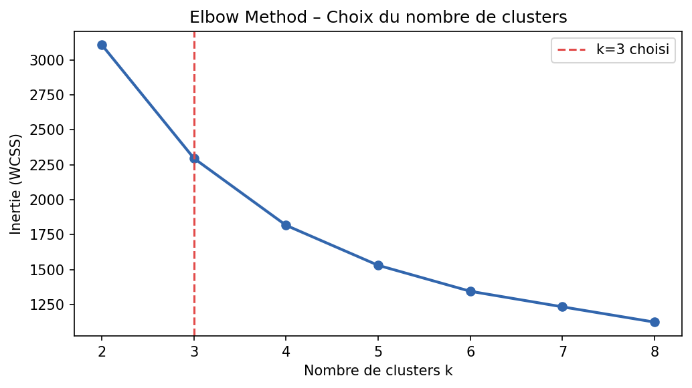
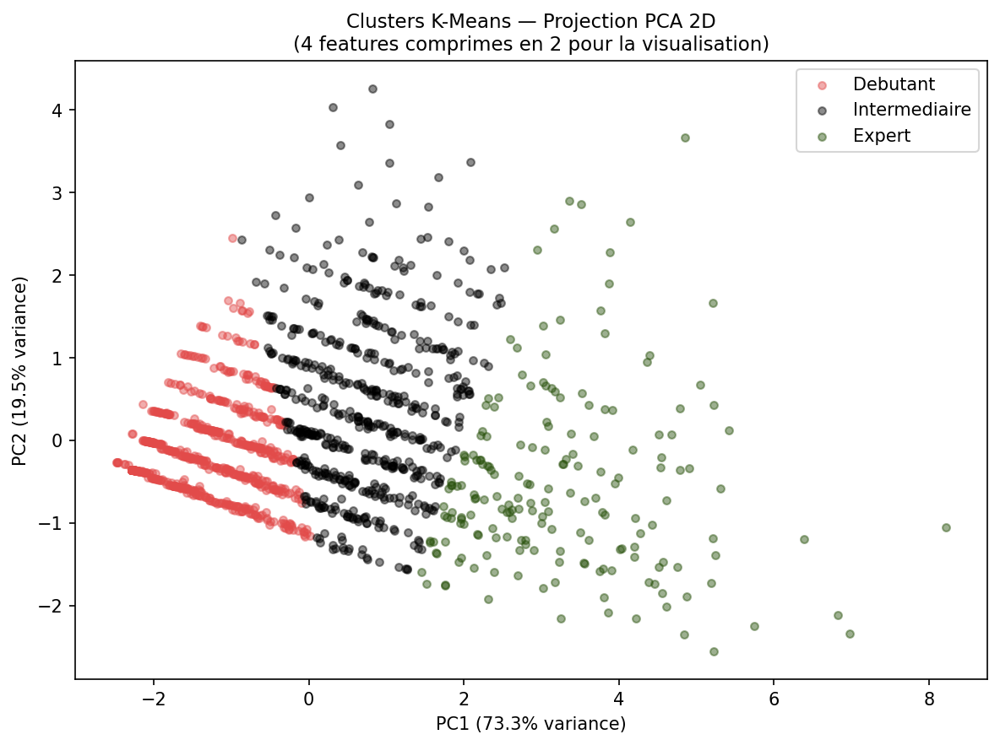
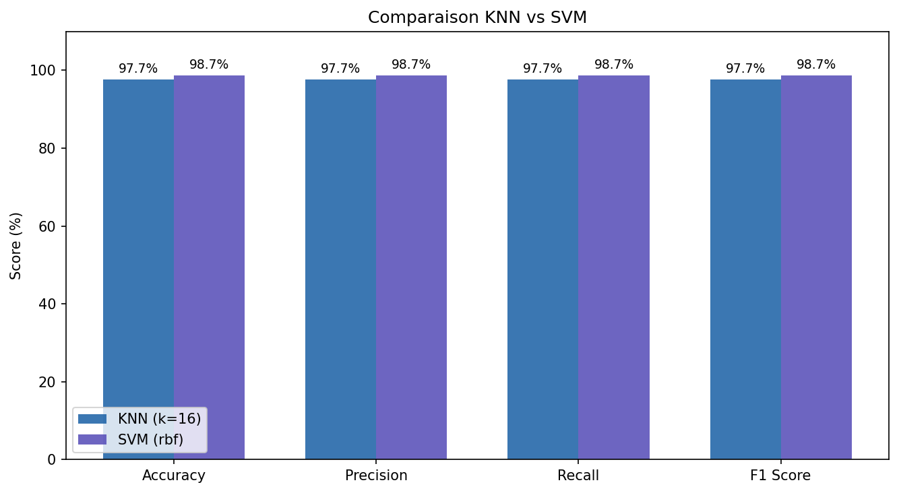
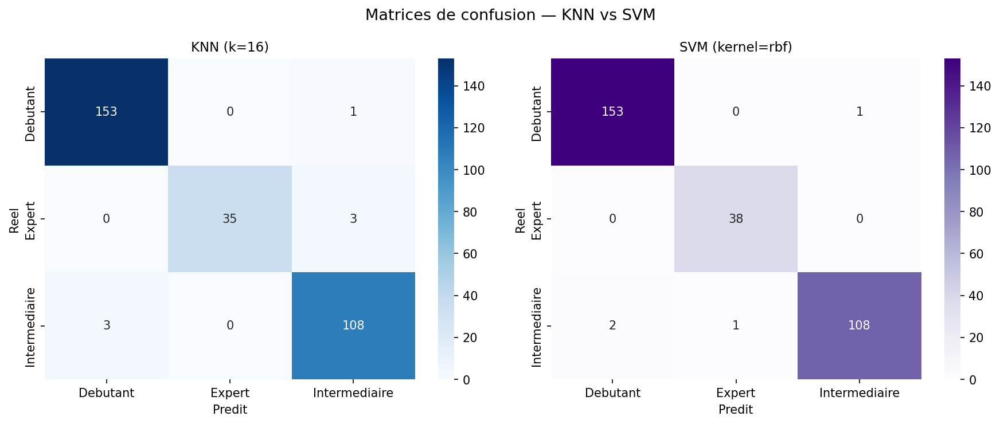

# 🎮 Neya eSports – Player Performance Classification

Machine learning pipeline that rates an eSports player's performance level (**Débutant / Intermédiaire / Expert**) from match statistics and tournament context, with an interactive Streamlit app for live predictions.

**🔗 Live demo:** [https://players-performance.streamlit.app/](https://players-performance.streamlit.app/)

---

## ⚡ TL;DR for reviewers

> **Step 1 (pseudo-labeling) is already done.**
> I extracted the match data from my team's database and labeled every performance using **K-Means** (unsupervised pseudo-labeling).
> The result is **`neya_labeled.csv`**, a dataset that already contains the class of each row (`skill_level`).
>
> **You don't need database access.** Take `neya_labeled.csv` and the code in `02_knn_svm.py` (SVM + KNN) and train your own models directly.

---

## What was already done (Step 1: pseudo-labeling)

The raw data comes from my team's private MySQL database (`players_stats`, `matches`, `tournaments`). It is **not included** in this repository, but the labeling step has already been run on it:

1. **Extraction**: kills, assists, damage, KO and tournament type for each player in each match.
2. **Pseudo-labeling with K-Means** (k = 3, chosen with the elbow method) on the game-quality stats only (`kills`, `assists`, `damage`, `KO`).
3. **Cluster naming**: clusters are ranked by their average damage → `Debutant` < `Intermediaire` < `Expert`.
4. **Context feature**: `tournament_pressure` (Scrims = 1 … Final = 6) was added to the dataset. It is **not** used by K-Means, only by the supervised models.
5. **Export** to `neya_labeled.csv`.

> **Note:** since the labels were produced by K-Means, they are *pseudo-labels*, not human-annotated ground truth. See [Limitations](#limitations).

### The labeled dataset: `neya_labeled.csv`

| Column | Description |
| --- | --- |
| `player_id` | Player identifier (12 players) |
| `kills`, `assists`, `damage`, `KO` | Match statistics (ML features) |
| `tournament_pressure` | Ordinal context feature (1 = Scrims … 6 = Final) |
| `skill_level` | **Target class** created by K-Means: `Debutant`, `Intermediaire`, `Expert` |

- 1,512 match records, 12 players
- Class distribution: Débutant 767 · Intermédiaire 557 · Expert 188

---

## What you can do with it (Step 2: train your own SVM / KNN)

`02_knn_svm.py` shows the full supervised pipeline on the already-labeled data:

- Features: `kills`, `assists`, `damage`, `KO`, `tournament_pressure`
- Target: `skill_level`
- Standardization with `StandardScaler`, stratified 80/20 split
- **KNN**: best `k` selected by 5-fold cross-validation
- **SVM (RBF kernel)**
- Comparison with accuracy / precision / recall / F1, confusion matrices and per-player profiles

Minimal example to train your own model from the labeled CSV:

```python
import pandas as pd
from sklearn.preprocessing import StandardScaler, LabelEncoder
from sklearn.model_selection import train_test_split
from sklearn.svm import SVC
from sklearn.neighbors import KNeighborsClassifier

df = pd.read_csv("neya_labeled.csv")
FEATURES = ["kills", "assists", "damage", "KO", "tournament_pressure"]

X = StandardScaler().fit_transform(df[FEATURES])
y = LabelEncoder().fit_transform(df["skill_level"])

X_train, X_test, y_train, y_test = train_test_split(
    X, y, test_size=0.2, random_state=42, stratify=y
)

svm = SVC(kernel="rbf", probability=True).fit(X_train, y_train)
knn = KNeighborsClassifier(n_neighbors=5).fit(X_train, y_train)

print("SVM:", svm.score(X_test, y_test))
print("KNN:", knn.score(X_test, y_test))
```

---

## Overview of the scripts

| Step | Script | What it does |
| ---- | ------ | ------------ |
| 1 ✅ *(already done)* | `01_kmeans.py` | Extracts match stats from MySQL, pseudo-labels each performance with **K-Means** (3 clusters, elbow method). **PCA** is used for visualization only. Produces `neya_labeled.csv`. |
| 2 | `02_knn_svm.py` | Trains and compares **KNN** and **SVM (RBF)** on the labeled data, with confusion matrices and player profiles. |
| 3 | `streamlit_app.py` | Web app: enter stats + tournament type, get the predicted level and class probabilities. |

### Design choices

- **K-Means** uses only game-quality stats (`kills`, `assists`, `damage`, `KO`), so a 0-kill final is still rated on play quality.
- **Tournament pressure** is an ordinal feature (Scrims = 1 … Final = 6) used by KNN/SVM only, so the models learn that context matters.
- Features are standardized (`StandardScaler`) and the data is split 80/20, stratified.

## Results

- SVM (RBF) test accuracy: **~98%** · KNN test accuracy: **~97%**

| Elbow method | PCA clusters |
| --- | --- |
| [](images/elbow_method.png) | [](images/clusters_pca_2d.png) |

| KNN vs SVM | Confusion Matrix |
| --- | --- |
| [](images/comparison_knn_svm.png) | [](images/confusion_matrices.png) |

## Limitations

- **Labels come from K-Means**, so the accuracy measures how well KNN/SVM reproduce the cluster boundaries, not real human-judged skill.
- The Débutant / Intermédiaire boundary overlaps; real data is not perfectly separable.
- Rows from the same 12 players appear in both train and test sets, which can make scores optimistic.

## Run the app

```bash
pip install -r requirements.txt
streamlit run streamlit_app.py
```

The app only needs `neya_labeled.csv`.

## Run the supervised pipeline (no database needed)

```bash
pip install -r requirements.txt
python 02_knn_svm.py        # trains KNN + SVM on neya_labeled.csv, saves plots in images/
```

## Regenerate the labels from a database (optional)

Only needed if you have your own MySQL database with the same schema (`players_stats`, `matches`, `tournaments`):

```bash
pip install -r requirements-dev.txt
cp .env.example .env        # then fill in your MySQL credentials
python 01_kmeans.py         # produces neya_labeled.csv
```

## Tech stack

Python · Pandas · NumPy · Scikit-learn · Matplotlib · Seaborn · MySQL · Streamlit

## Project structure

```
├── 01_kmeans.py             # Step 1: pseudo-labeling (already done)
├── 02_knn_svm.py            # Step 2: KNN + SVM training/comparison
├── streamlit_app.py         # Step 3: web app
├── neya_labeled.csv         # Labeled dataset (output of step 1)
├── images/
├── requirements.txt         # app + supervised pipeline
├── requirements-dev.txt     # full pipeline incl. MySQL
├── .env.example
└── .gitignore
```

## Author

**BAHIJ** – [GitHub](https://github.com/bahij7) · [LinkedIn](https://linkedin.com/in/ahmedbahij)
